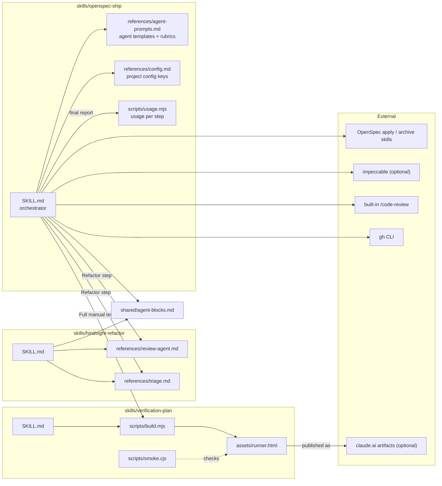
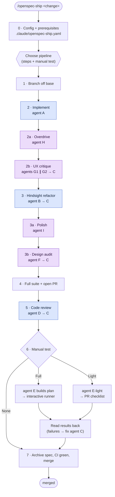
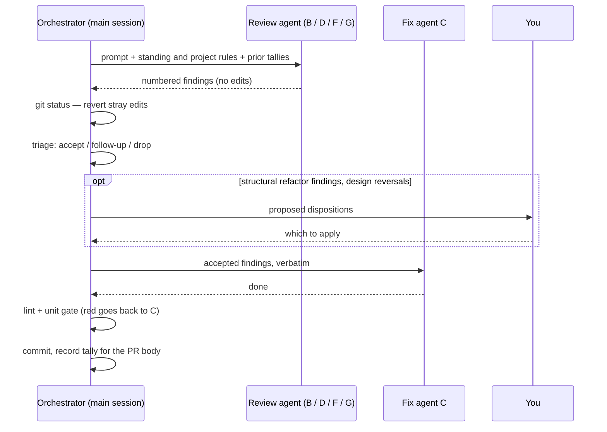
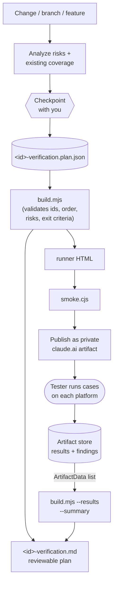
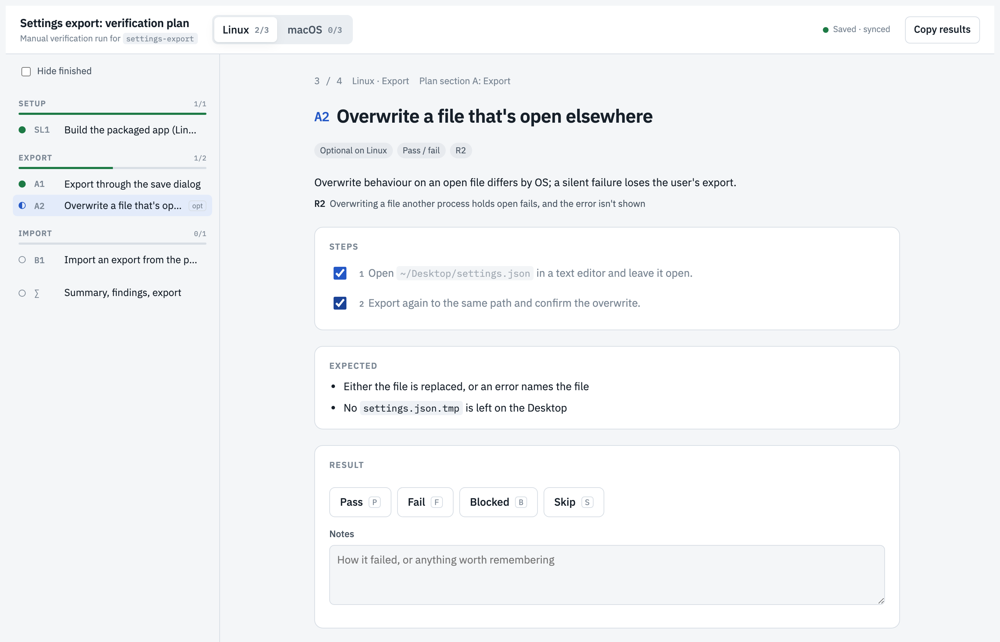

# ai-skills

A Claude Code plugin marketplace.

| Plugin | Skills | What it does |
|---|---|---|
| [`openspec-ship`](plugins/openspec-ship) | `openspec-ship`, `hindsight-refactor`, `verification-plan` | Takes an [OpenSpec](https://github.com/Fission-AI/OpenSpec) change from proposal to merged PR, reviews finished work with hindsight, and writes risk-based manual test plans as an interactive runner. |

## Install

```
/plugin marketplace add apmiller108/ai-skills
/plugin install openspec-ship@ai-skills
```

From a local checkout (edits apply on `/reload-plugins`, no reinstall):

```
claude plugin marketplace add ~/dev/ai-skills
claude plugin install openspec-ship@ai-skills
```

## Module structure

```
.claude-plugin/marketplace.json          marketplace manifest (lists the plugins)
plugins/openspec-ship/
├── .claude-plugin/plugin.json           plugin manifest
├── shared/agent-blocks.md               standing rules and report lines for agent prompts
└── skills/
    ├── openspec-ship/
    │   ├── SKILL.md                     the orchestrator: menu, steps 0–7, commits, state file
    │   ├── references/
    │   │   ├── agent-prompts.md         prompt template per subagent, triage rubrics
    │   │   ├── baseline-check.md        was a failing spec already failing on the base?
    │   │   └── config.md                every key of .claude/openspec-ship.yaml
    │   ├── scripts/usage.mjs            token usage per agent, from the session transcripts
    │   └── scripts/usage.test.mjs       its tests (node --test)
    ├── hindsight-refactor/
    │   ├── SKILL.md                     target → learnings → review agent → triage → checkpoint → apply
    │   ├── references/review-agent.md   the review agent's prompt
    │   └── references/triage.md         accept / follow-up / drop, and what you decide
    └── verification-plan/
        ├── SKILL.md                     analyze → checkpoint → plan JSON → build → publish → read back
        ├── references/plan-schema.md    the plan JSON schema
        ├── examples/settings-export.plan.json   a complete small plan
        ├── scripts/build.mjs            validate the plan; render Markdown + runner HTML; fold results back
        ├── scripts/smoke.cjs            headless check of a built runner (jsdom)
        └── assets/runner.html           the runner template the plan is injected into
```

`hindsight-refactor` and `verification-plan` work on their own for any branch or feature.
`openspec-ship` reuses the first's prompt and rubric for its Refactor step, and the second's
scripts and runner for the Full manual test.



## openspec-ship

### The agentic pipeline

The main session is an **orchestrator**. It owns the branch, the commits, the PR, every
accept/reject decision and every conversation with you. Subagents do the reading and
editing, and send back short, capped reports. A skill can't `/compact`, so this split is
what keeps the main context small enough to take a change all the way to merge.

Every agent works under the same standing rules: follow the project's `safety` block, stop
at a denied command and report it (the orchestrator asks you), and write temp files only
to its own scratch folder.

The run opens with one menu where you toggle the optional steps and pick the manual
test plan. Branch, PR and merge always run; specs (lint + unit) run after every step
that changes code, and red is never committed. Every gate keeps its own exit code, in the
background too; its output goes to a log and only the tail is read. A full-suite failure is
first reproduced on the base, in a throwaway worktree: one that was already there is named
in the PR and left to CI, which still has to be green.



<sub>Blue: optional steps. Purple: optional UI steps, offered only when the change touches
`ui.paths` and [impeccable](https://github.com/pbakaus/impeccable) is installed. Skipped
steps drop out of the chain.</sub>

| Step | Agent(s) | Edits? | What happens |
|---|---|---|---|
| Implement | **A** apply | yes | Runs `openspec-apply-change`, works through `tasks.md` (ticking a task only when its own check passed on the final code), reports LEARNINGS for the refactor step. |
| Overdrive | **H** overdrive | yes, after you pick | Proposes 2–3 ambitious UI directions; you pick one (or none) and the same agent builds it. |
| UX critique | **G1** design review ∥ **G2** detector | no | Two isolated assessments run in parallel; the orchestrator cross-checks and keeps only fixes a real user would notice. |
| Refactor | **B** refactor | no | "Knowing what we know now": numbered STRUCTURAL / CODE findings, each with the risk of changing it and how to check that. Structural ones, and any that reverse a `design.md` decision, are shown to you before they're applied. |
| Polish | **I** polish | yes | Refinement within the existing design: spacing, states, token drift, copy fit. |
| Design audit | **F** design audit | no | `impeccable audit` against the design doc, WCAG AA and the copy guide. |
| Code review | **D** review | no | Built-in `/code-review` at effort `high` on the PR; only critical bugs are fixed, each with a regression test. |
| Manual test | **E** / **E-light** | plan only | Full: a verification plan of at most 8 cases, published as a runner. Light: 3–6 checkboxes in the PR body. |
| *any fix* | **C** fix | yes | Applies the accepted findings, copied verbatim from the triage: a regression test for each behaviour fix, and each finding's risk check, measured. |

The review steps all follow the same loop: a report-only agent, triage in the main
session against a rubric (the refactor one is `hindsight-refactor`'s), one fix agent, then
the gate:



Verification tasks in `tasks.md` are tied to the code they ran on. Slow ones (full suite,
performance, packaged build) run in step 4, any that a later fix could affect run again, and
nothing is archived with one that's neither passed nor waived by you.

An agent that departs from a recorded decision updates `design.md` in the same pass and
reports it; step 7 checks each reported deviation before the change is archived.

Progress is kept in a state file at `.git/openspec-ship/<change>.md` (local, never
committed), so a run that stops for days — waiting on a question or a manual test pass —
resumes at the right step with the same pipeline.

Each menu option carries a rough cost, and the final report has a token usage table: a row
per agent, by step, including nested agents and the orchestrator. The state file records
which agent ran which step, and `usage.mjs` adds up their transcripts in `~/.claude/projects`.
To measure any session:

```
node plugins/openspec-ship/skills/openspec-ship/scripts/usage.mjs --session <session-id> [--json]
```

### Requirements

| | |
|---|---|
| Claude Code ≥ 2.1.323 | the built-in `code-review` skill, and `${CLAUDE_SKILL_DIR}` in skills |
| [OpenSpec](https://github.com/Fission-AI/OpenSpec) CLI, with `openspec init` run in the repo | provides `openspec-apply-change` and `openspec-archive-change` |
| `gh`, authenticated | branch, PR, checks, merge |
| [impeccable](https://github.com/pbakaus/impeccable) *(optional)* | enables the UI review steps: overdrive, critique, polish, design audit. `/plugin marketplace add pbakaus/impeccable` |
| claude.ai artifacts *(optional)* | the Full manual test runner. Without them, the manual test is Light (PR checklist) or None |

impeccable isn't a hard dependency on purpose: its steps only apply to UI changes, it
installs a hook, and many repos already vendor it as a project skill.

### Project config

Each repo gets a committed `.claude/openspec-ship.yaml` with its lint and test commands,
where UI code lives, how to run and screenshot the app, which platforms to test on, and
project rules every agent should follow. It also needs a `safety` block: how to run the
app and the suites without touching your real data (`none` is fine, but you have to say
so; a run stops without it). You don't write it by hand: on the first run the
skill drafts it from `package.json`, CI config and `CLAUDE.md`, shows it to you, and
commits it with the change. See
[`references/config.md`](plugins/openspec-ship/skills/openspec-ship/references/config.md)
for every key.

### Use

```
/openspec-ship:openspec-ship add-settings-export
```

or just ask: "ship the add-settings-export change".

## hindsight-refactor

Reviews work that's already built and asks: knowing what we know now, what would we do
differently? It runs on its own for an OpenSpec change, a branch, a PR or a described
feature, and is what `openspec-ship` uses for its Refactor step.

It starts from what the build taught: your notes, the session that built it, or the
learnings an `openspec-ship` run saved. A fresh agent that only reports reviews the diff and
the code around it, and every finding names a concrete cost, the risk of changing it and
how to check that. The findings are triaged, you pick which to apply, and nothing is
committed unless you ask.

### Use

```
/openspec-ship:hindsight-refactor add-settings-export
```

or ask: "knowing what we know now, what would you change on this branch?"

## verification-plan

Writes a risk-based manual test plan: only the cases automation can't cover (real OS
dialogs, packaged-build paths, cross-platform file behaviour, destructive one-shot flows),
ordered so nothing destructive runs before the cases that need its data. It runs on its
own for any OpenSpec change, branch or described feature, and is what `openspec-ship`
uses for the Full manual test.

One plan JSON produces both outputs, so they never drift:



The runner gives each platform its own tab and run order. The tester ticks steps, copies
commands, records Pass / Fail / Blocked / Skip with notes, and logs findings. Results
sync through the artifact's store (so a laptop and a test VM share one run), survive
republishing, and Claude reads them back to gate the merge.



<sub>The runner built from
[`examples/settings-export.plan.json`](plugins/openspec-ship/skills/verification-plan/examples/settings-export.plan.json),
a mock plan.</sub>

### Use

```
/openspec-ship:verification-plan add-settings-export
```

or ask: "what do I need to test before shipping this branch?"
